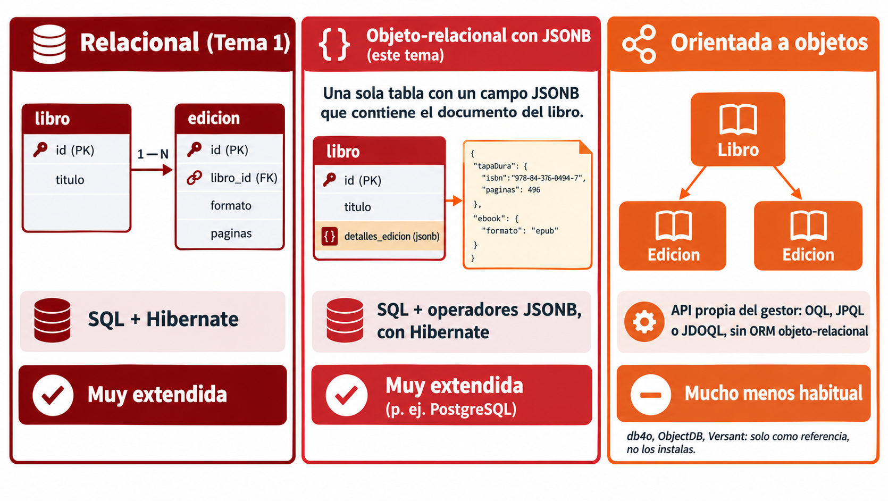
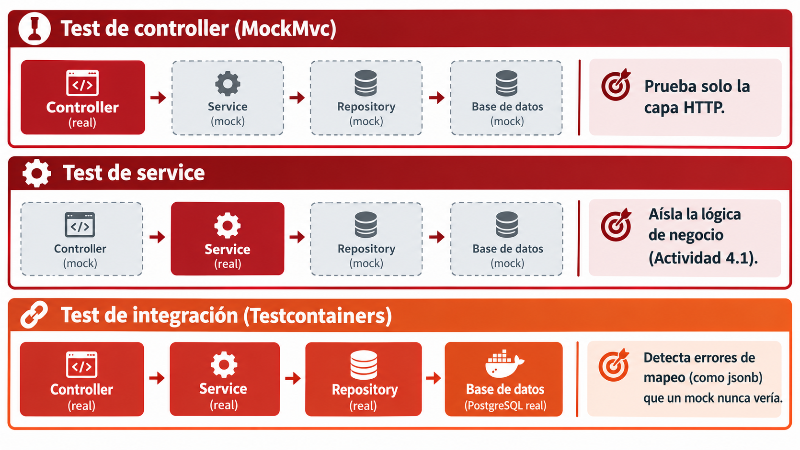
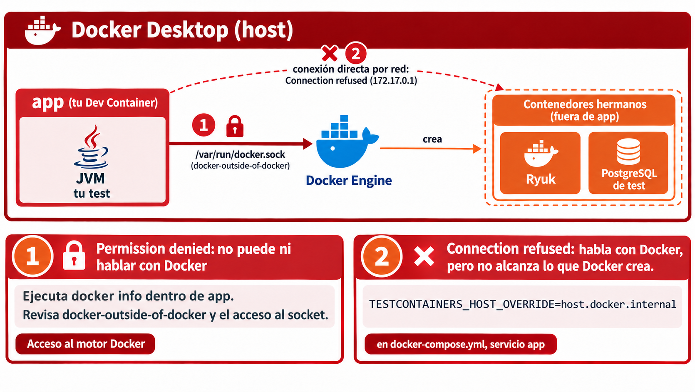
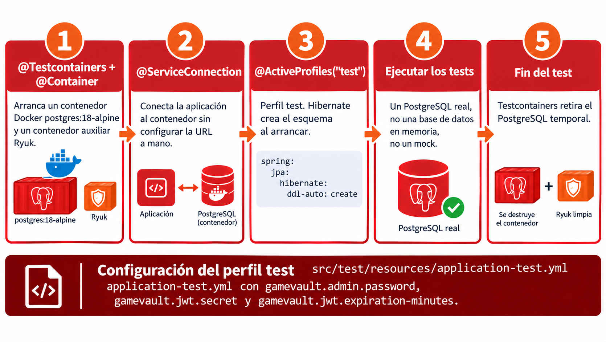
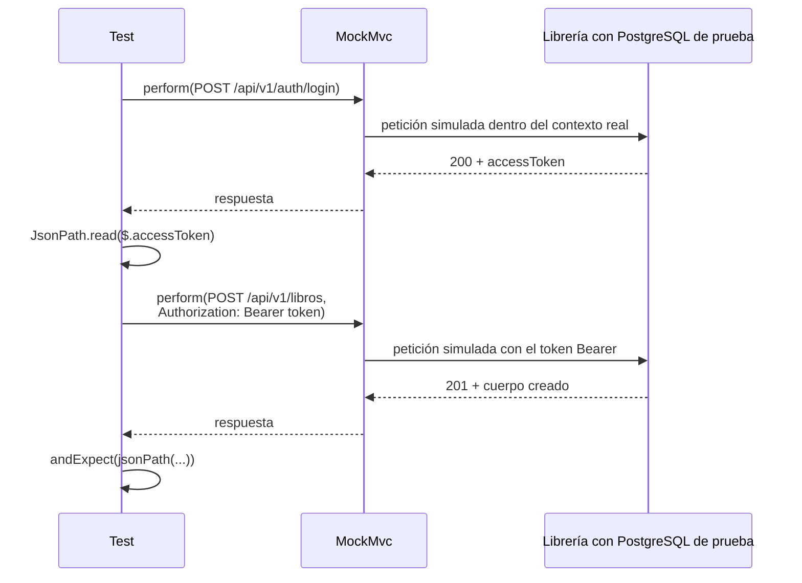
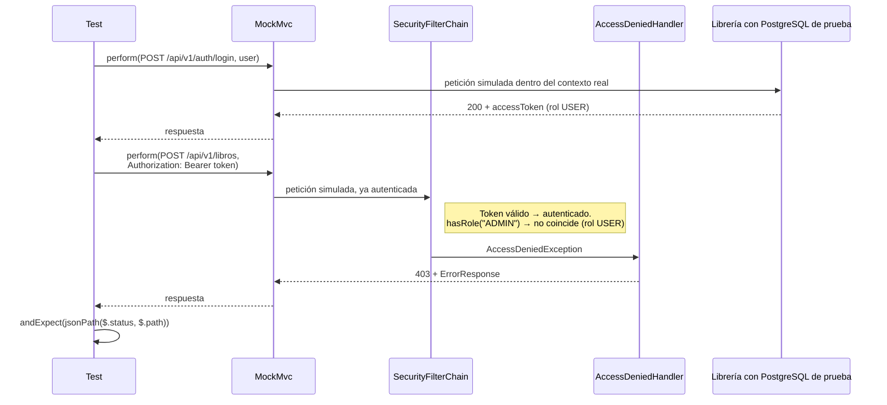

<a id="bd-orientadas-a-objetos"></a>

# 🧩 3. Bases de datos orientadas a objetos, pruebas y documentación

{ type=application/pdf style="width:100%;min-height:80vh" }

!!!info "Descarga de diapositivas"
    [Descarga las diapositivas](diapositivas/bd-orientadas-a-objetos.pptx){target="_blank" rel="noopener"}

---

Este apartado tiene dos partes bien diferenciadas: primero un bloque teórico sobre una categoría de bases de datos que no vas a usar en las prácticas —lo ves de forma conceptual, sin instalar ni configurar nada—, y después las pruebas que dan por buenas todas las piezas construidas hasta ahora.

---

## 🧊 Bases de datos orientadas a objetos puras

!!! info "Idea clave"
    Una base de datos orientada a objetos almacena directamente el estado de los objetos, su identidad y las relaciones que mantienen entre ellos, sin descomponerlos previamente en el modelo relacional de filas, columnas y claves foráneas.

    Esto no significa que copie literalmente un objeto Java tal como existe en la memoria del programa. El gestor utiliza su propia representación interna, pero su modelo lógico se basa en objetos y referencias, no en tablas relacionales.

Con los tres modelos ya vistos —el relacional puro del Tema 1, el objeto-relacional con JSONB de este mismo tema, y este último— conviene verlos uno junto a otro:

| | Relacional (Tema 1) | Objeto-relacional con JSONB (este tema) | Orientada a objetos |
|---|---|---|---|
| **Modelo de almacenamiento** | Tablas, filas, columnas y relaciones | Modelo relacional, con tipos avanzados como `jsonb` | Objetos, identidades y referencias |
| **Acceso desde Java** | JDBC directamente o mediante un ORM como Hibernate | SQL/JDBC o, como en este curso, Hibernate | API específica del gestor o estándares orientados a objetos |
| **Lenguaje de consulta** | SQL | SQL y operadores o funciones JSONB | Depende del gestor: OQL, JPQL, JDOQL o APIs propias |
| **Adopción** | Muy extendida | Muy extendida en gestores como PostgreSQL | Mucho menos habitual |



*Figura 1. Tres formas de representar un libro y sus ediciones. Elaboración propia.*

Esa última fila resume la desventaja real de este modelo: menos documentación, menos gente con experiencia a la que preguntar, y el riesgo de quedarte atado a un gestor que puede dejar de mantenerse — por eso casi nadie elige hoy una BD orientada a objetos pura para un proyecto nuevo.

Al no existir la separación entre objetos y tablas relacionales, no hace falta un **ORM objeto-relacional** como Hibernate. Sigue siendo necesaria una API o un controlador que permita al programa comunicarse con el gestor, pero ya no tiene que traducir entidades a filas y claves foráneas.

**OQL** (*Object Query Language*) es uno de los lenguajes asociados históricamente a este modelo, pero no es una opción universal. Cada gestor puede ofrecer lenguajes y APIs diferentes. Algunos utilizan OQL; otros, como ObjectDB, permiten consultar directamente mediante JPQL o JDOQL sin traducir después la consulta a SQL.

!!! note "Algunos gestores, solo como referencia"
    **db4o**, **ObjectDB** y **Versant** son ejemplos representativos —algunos principalmente históricos— de este tipo de bases de datos. No todos utilizan el mismo lenguaje de consulta ni ofrecen las mismas APIs. No vas a instalar ninguno: este bloque es puramente conceptual.

---

## 🧪 Pruebas y documentación

De vuelta al código: cómo se prueba y documenta lo construido en este tema.

### Test de capa (controller, y más adelante service)

Ya conoces el test de **controller**, del Tema 1 de PSP (aunque aquí es Acceso a Datos, la idea es la misma): con MockMvc, mockeando el service, prueba solo la capa HTTP — y aplica igual cuando la entidad lleva una columna JSONB, como aquí. Existe también el test de **service**, que aísla la lógica de negocio mockeando el repositorio en su lugar — pero ese lo construyes más adelante, en la Actividad 4.1 de este mismo módulo; no hace falta todavía.

### Test de integración real (con Testcontainers)

Los dos tests de arriba tienen algo en común: ninguno utiliza una base de datos real. En el test de controller se sustituye el service. En el de service se sustituye el repositorio. Los recuadros grises de la figura representan capas que quedan fuera de la ejecución. **Testcontainers** es la librería que resuelve ese hueco — levanta contenedores Docker reales (una base de datos, una cola de mensajes, lo que haga falta) solo para la duración del test, y los destruye al terminar, sin dejar nada instalado en tu máquina ni depender de ningún servicio externo compartido. No viene incluida en ningún starter que ya tengas — es la primera vez que aparece en el curso, así que hace falta añadirla.



*Figura 2. Capas que intervienen en los tests de controller, de service y de integración. Elaboración propia.*

El `spring-boot-starter-parent` gestiona las versiones de los módulos de **Testcontainers 2**.

!!! info "Idea clave: qué es un BOM"
    Un **BOM** (*Bill of Materials*, «lista de materiales») es un POM especial que coordina las versiones de un conjunto de artefactos compatibles. Spring Boot incorpora esa gestión de versiones. Tú declaras en `pom.xml` los módulos que vas a utilizar.

Añade las siguientes dependencias al bloque `<dependencies>` de tu proyecto.

```xml
<dependency>
    <groupId>org.springframework.boot</groupId>
    <artifactId>spring-boot-testcontainers</artifactId>
    <scope>test</scope>
</dependency>
<dependency>
    <groupId>org.testcontainers</groupId>
    <artifactId>testcontainers-junit-jupiter</artifactId>
    <scope>test</scope>
</dependency>
<dependency>
    <groupId>org.testcontainers</groupId>
    <artifactId>testcontainers-postgresql</artifactId>
    <scope>test</scope>
</dependency>
```

Esto también deja el terreno preparado para el resto del curso: cuando más adelante añadas otros contenedores de Testcontainers (MongoDB, RabbitMQ...), ninguno va a necesitar tampoco su propia `<version>` — la versión la gestiona Spring Boot.

!!! tip "Por qué esto funciona dentro de tu Dev Container"
    Testcontainers necesita arrancar contenedores de verdad — y tu proyecto entero corre dentro de un contenedor (`app`) desde la Actividad 1.1. Funciona porque, ya desde entonces, has montado el socket de Docker del host dentro de `app` y has añadido la *feature* `docker-outside-of-docker`: tu contenedor puede pedirle contenedores nuevos al mismo Docker que usa tu sistema operativo, sin necesitar un Docker propio dentro del Docker.



*Figura 3. Acceso al motor Docker y a los puertos de los contenedores desde el Dev Container. Elaboración propia.*

!!! warning "`docker info` falla dentro de `app`"
    Comprueba que Docker está iniciado y que tu Dev Container se ha creado con `docker-outside-of-docker`. Si el error es `Permission denied` sobre el socket, revisa el usuario y los permisos que tiene en ese entorno antes de seguir.

!!! warning "Docker arranca Ryuk, pero aparece `Connection refused`"
    Ryuk ayuda a retirar los recursos temporales del test. Si usas Docker Desktop desde un Dev Container y el log muestra que la JVM intenta alcanzarlo por una IP como `172.17.0.1`, añade `TESTCONTAINERS_HOST_OVERRIDE: host.docker.internal` a `environment` del servicio `app` en `.devcontainer/docker-compose.yml`. Reconstruye el Dev Container. Esa dirección permite que la JVM llegue a los puertos publicados de Ryuk y PostgreSQL. [Testcontainers con Docker Desktop](https://java.testcontainers.org/supported_docker_environment/continuous_integration/dind_patterns/)

Si ejecutas Maven en el equipo anfitrión, o en un job de GitHub Actions sobre `ubuntu-latest` sin `container:`, Testcontainers utiliza Docker desde ese entorno. Si tu CI filtra las pruebas con `-Dtest`, incluye también la clase de integración. [Ejecución de jobs en GitHub Actions](https://docs.github.com/en/actions/how-tos/write-workflows/choose-where-workflows-run/run-jobs-in-a-container)

Importa `org.testcontainers.postgresql.PostgreSQLContainer`. La clase de test queda así:

```java
@SpringBootTest
@AutoConfigureMockMvc
@ActiveProfiles("test")
@Testcontainers
class LibreriaApiTest {

    @Container
    @ServiceConnection
    static final PostgreSQLContainer postgres = new PostgreSQLContainer("postgres:18-alpine");

    @Autowired
    private MockMvc mockMvc;

    // ...
}
```

`@Testcontainers` + `@Container` levantan un **PostgreSQL real** dentro de un contenedor Docker, solo para la duración del test — no una base de datos en memoria, no un mock. `@ServiceConnection` conecta automáticamente ese contenedor a tu aplicación de test, sin que configures manualmente la URL de conexión. `@ActiveProfiles("test")` activa un perfil propio, distinto del `dev` de siempre — Hibernate crea el esquema con `ddl-auto: create` al arrancar el contexto. Testcontainers retira el PostgreSQL temporal al finalizar la clase. Los métodos de la misma clase comparten el contenedor, así que cada prueba debe preparar sus propios datos.

!!! warning "La anotación sola no basta: el perfil `test` tiene que existir"
    `@ActiveProfiles("test")` le dice a Spring qué perfil activar, pero no crea nada por sí sola — igual que te pasó con `dev` al depurar `GamevaultApplicationTests` (PSP, Actividad 1.3). Y aquí hay tres propiedades que, sin valor, impiden arrancar del todo: `@Value("${gamevault.admin.password}")` (el `ApplicationRunner` que siembra el `admin`), `@Value("${gamevault.jwt.secret}")` (los beans `JwtEncoder`/`JwtDecoder`) y `@Value("${gamevault.jwt.expiration-minutes}")` (`JwtService`, para construir cualquier token) — ninguna de las tres lleva un valor por defecto, así que sin ellas el contexto ni siquiera llega a levantarse, y ningún test de la clase se ejecuta. `spring.datasource` no hace falta escribirlo: eso ya lo resuelve `@ServiceConnection` en tiempo de ejecución. Crea `src/test/resources/application-test.yml`. `spring.sql.init.mode: never` evita que `data.sql` cargue los datos de desarrollo:
    ```yaml
    spring:
      jpa:
        hibernate:
          ddl-auto: create
      sql:
        init:
          mode: never

    gamevault:
      admin:
        password: admintest123
      jwt:
        secret: un-secreto-de-test-de-al-menos-32-caracteres-largo
        expiration-minutes: 60
    ```
    La contraseña que pongas aquí tiene que ser exactamente la misma que envíe `loginComoAdmin()` en su petición de login, más abajo — los dos viven dentro del mismo mundo de test, aislado del perfil `dev` (que ni siquiera se carga con `@ActiveProfiles("test")` activo). De ahí el nombre `admintest123`: dice de un vistazo que es una credencial solo de test, sin que tengas que recordar que no tiene relación con la de `dev`. El valor de `expiration-minutes`, en cambio, no importa para el test — `60` (el mismo de `dev`) sirve igual que cualquier otro.
    Este fichero puede subirse a Git porque contiene valores ficticios, utilizados únicamente por el perfil `test` y por una base de datos desechable. La condición es que esas credenciales y secretos no se reutilicen nunca en `dev`, producción ni en ningún servicio persistente o compartido.



*Figura 4. Ciclo de vida de PostgreSQL en un test de integración con Testcontainers. Elaboración propia.*

¿Por qué esto da más confianza que mockear el repositorio? Porque prueba el mapeo JSONB **real** contra un PostgreSQL **real** — una base de datos en memoria genérica (como H2) podría no soportar `jsonb_exists` exactamente igual, o ni siquiera soportar el tipo `jsonb` de PostgreSQL. Un test con Testcontainers detectaría un error de mapeo que un test con mocks jamás vería, porque el mock nunca ejecuta SQL de verdad contra ningún motor.

### Peticiones autenticadas dentro del test

Los ejemplos de este apartado usan Librería. En su perfil de prueba, las propiedades de administrador y JWT llevan el prefijo `libreria`. Si tu API tiene rutas protegidas —y a estas alturas del curso ya las tiene, con roles y todo—, el test debe recorrer el mismo flujo de autenticación y autorización de la aplicación: no hay ningún atajo que salte la seguridad «porque es un test».

`MockMvc` no abre una conexión HTTP real ni arranca un servidor. Construye peticiones y respuestas simuladas, pero las hace pasar por el `DispatcherServlet`, la cadena de filtros de seguridad, los controllers y el resto del contexto real de Spring. Por eso puedes realizar el login, extraer el token y utilizarlo después en otra petición dentro del test.



Primero va el ayudante que hace login y devuelve el token. En el test de Librería, `crearEditorialDePrueba()` representa la preparación de una editorial en PostgreSQL y devuelve su ID. Puedes guardarla con `EditorialRepository` antes del `POST`.

```java
private String loginComoAdmin() throws Exception {
    String respuesta = mockMvc.perform(post("/api/v1/auth/login")
                    .contentType(MediaType.APPLICATION_JSON)
                    .content("""
                            {
                              "username": "admin",
                              "password": "admintest123"
                            }
                            """))
            .andExpect(status().isOk())
            .andReturn()
            .getResponse()
            .getContentAsString();

    return JsonPath.read(respuesta, "$.accessToken");
}

@Test
void crearLibro_DebeGuardarDetallesEdicion_CuandoEsValido() throws Exception {
    String adminToken = loginComoAdmin();
    long editorialId = crearEditorialDePrueba();

    String respuesta = mockMvc.perform(post("/api/v1/libros")
                    .header("Authorization", "Bearer " + adminToken)
                    .contentType(MediaType.APPLICATION_JSON)
                    .content("""
                            {
                              "titulo": "Rayuela",
                              "precio": 16.40,
                              "fechaPublicacion": "1963-06-28",
                              "editorialId": %d,
                              "detallesEdicion": {"editorial": "Sudamericana", "paginas": 634}
                            }
                            """.formatted(editorialId)))
            .andExpect(status().isCreated())
            .andReturn().getResponse().getContentAsString();

    Number id = JsonPath.read(respuesta, "$.id");
    mockMvc.perform(get("/api/v1/libros/{id}", id.longValue()))
            .andExpect(status().isOk())
            .andExpect(jsonPath("$.titulo").value("Rayuela"))
            .andExpect(jsonPath("$.detallesEdicion.editorial").value("Sudamericana"));
}
```

`loginComoAdmin()` no lleva `@Test`: es un método ayudante que cualquier otro test de la clase puede utilizar cuando necesite un token válido. Requiere `import com.jayway.jsonpath.JsonPath;`, disponible con las dependencias de pruebas de Spring Boot.

El `POST` verifica el alta y proporciona el ID. El `GET` posterior comprueba que la aplicación puede recuperar desde PostgreSQL el libro y la propiedad anidada `detallesEdicion.editorial`.

### Comprobar también los casos de error

Un test de integración que solo prueba el camino feliz deja fuera la mitad del comportamiento real de tu API: qué pasa cuando la petición **no** debería tener éxito. Los manejadores de MVC y Spring Security comparten el formato `ErrorResponse` — y ese formato también se comprueba con `jsonPath`, campo a campo, igual que un cuerpo de éxito. Aquí la petición sí está autenticada —el token de `user` es válido—, pero no autorizada, así que ni siquiera llega a tu controller:



El test reproduce ese flujo y comprueba el cuerpo del error. `registrarYAutenticarUsuario()` representa el registro de una cuenta de prueba y su login para obtener un JWT de `USER`.

```java
@Test
void crearLibro_DebeDevolver403_CuandoElUsuarioNoEsAdmin() throws Exception {
    long editorialId = crearEditorialDePrueba();
    String userToken = registrarYAutenticarUsuario();

    mockMvc.perform(post("/api/v1/libros")
                    .header("Authorization", "Bearer " + userToken)
                    .contentType(MediaType.APPLICATION_JSON)
                    .content("""
                            {
                              "titulo": "Rayuela",
                              "precio": 16.40,
                              "fechaPublicacion": "1963-06-28",
                              "editorialId": %d,
                              "detallesEdicion": {"editorial": "Sudamericana", "paginas": 634}
                            }
                            """.formatted(editorialId)))
            .andExpect(status().isForbidden())
            .andExpect(jsonPath("$.status").value(403))
            .andExpect(jsonPath("$.path").value("/api/v1/libros"));
}
```

No es casualidad que este test compruebe el cuerpo del error, no solo el código `403`: dos errores distintos pueden compartir el mismo código de estado, y solo el cuerpo —con tu propio `ErrorResponse`, no el genérico de Spring— dice cuál de los dos ha ocurrido de verdad. Quedarte solo con `status().isForbidden()` dejaría pasar una regresión real: por ejemplo, que el `403` siga llegando pero con el formato por defecto de Spring Security en vez del tuyo, porque alguien ha desconectado sin querer tu `AccessDeniedHandler`.

!!! tip "Qué comprobar en un test de integración, en general"
    Tres cosas, casi siempre: el código de estado (`status()`), la forma del cuerpo cuando lo hay (`jsonPath` sobre los campos que de verdad importan, no todos), y —cuando la petición debía cambiar algo— que ese cambio ha persistido de verdad, con una segunda petición (normalmente un `GET`) que lo confirme. Un test así, con un nombre que dice exactamente qué caso cubre (`crearLibro_DebeDevolver403_CuandoElUsuarioNoEsAdmin`), documenta ese comportamiento mejor que un README aparte — y a diferencia de un README, no puede quedarse desactualizado sin que te enteres: si el comportamiento cambia, el test falla.

---

## ✅ Ideas clave

??? tip "Abrir resumen"

    - Una base de datos orientada a objetos almacena el estado, la identidad y las referencias de los objetos sin descomponerlos en tablas relacionales; por eso no necesita un ORM objeto-relacional, aunque sí una API para comunicarse con el gestor.
    - OQL es uno de los lenguajes asociados históricamente a este modelo, pero no es universal: cada gestor puede utilizar OQL, JPQL, JDOQL o APIs propias.
    - Comparado con relacional puro y objeto-relacional (JSONB), lo orientado a objetos puro tiene poquísima adopción real — la razón de que este bloque sea conceptual y no práctico.
    - Un test de **controller** (ya conocido, PSP Tema 1) prueba la capa HTTP mockeando el service; un test de **service** hace lo análogo mockeando el repositorio, pero eso llega en la Actividad 4.1; un test de **integración** con Testcontainers levanta un motor real en Docker.
    - Testcontainers detecta errores de mapeo real (como con `jsonb`) que un mock nunca podría detectar.
    - Contra rutas protegidas, MockMvc reproduce el flujo real de login, filtros y autorización y extrae el token con `JsonPath`, aunque utiliza peticiones simuladas y no un servidor HTTP real.
    - Los casos de error también se comprueban con `jsonPath`, campo a campo del `ErrorResponse` — no basta con el código de estado, porque dos errores distintos pueden compartir el mismo.
    - Un test bien nombrado actúa como documentación ejecutable: si cambia alguno de los comportamientos que comprueba, el test falla. No sustituye toda la documentación escrita y solo documenta los casos que realmente cubre.
